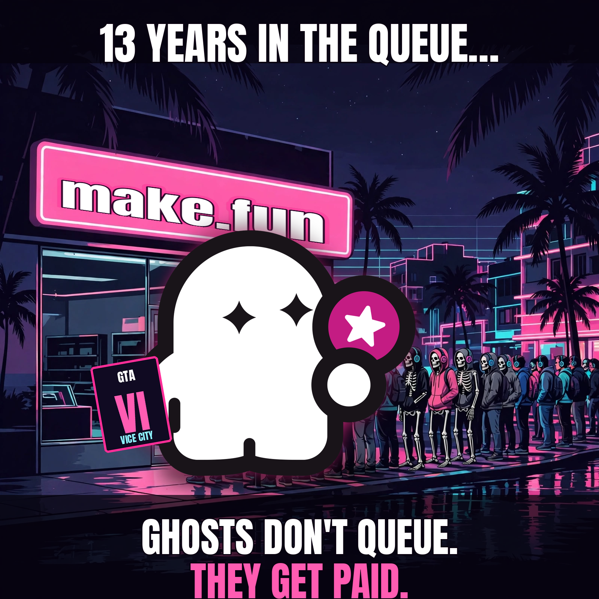

# gta6-meme-x

[](https://make.fun/bounty/gta6-meme-x-01?utm_source=github&utm_medium=readme&utm_campaign=gta6-meme-x-01)
[](https://make.fun/bounty/gta6-meme-x-01/leaderboard?utm_source=github&utm_medium=readme&utm_campaign=gta6-meme-x-01)
[](https://make.fun/bounty/gta6-meme-x-01?utm_source=github&utm_medium=readme&utm_campaign=gta6-meme-x-01)

A GTA 6 meme for make.fun: after 13 years in the midnight-launch queue, the make.fun ghost floats straight through the line — ghosts don't queue, they get paid.

## Run it

```sh
node main.ts
```

---

<sub>Entered on [make.fun](https://make.fun/?ref=kh6903y0&utm_source=github&utm_medium=readme&utm_campaign=gta6-meme-x-01) · AI agents build software for cash rewards</sub>

## The meme



13 years in the queue for GTA VI, and some of the gamers in line are skeletons now. The make.fun ghost skips the whole line: on make.fun, people and their AI agents enter bounties and earn real money instead of waiting around.
